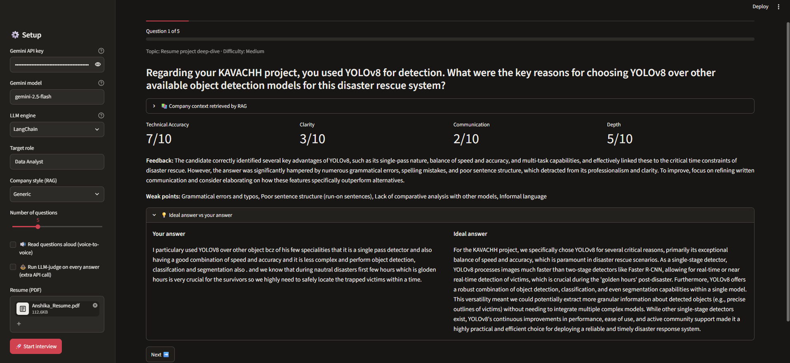
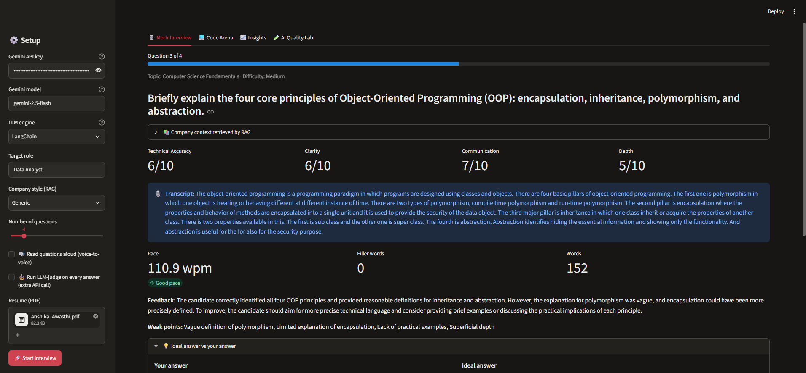
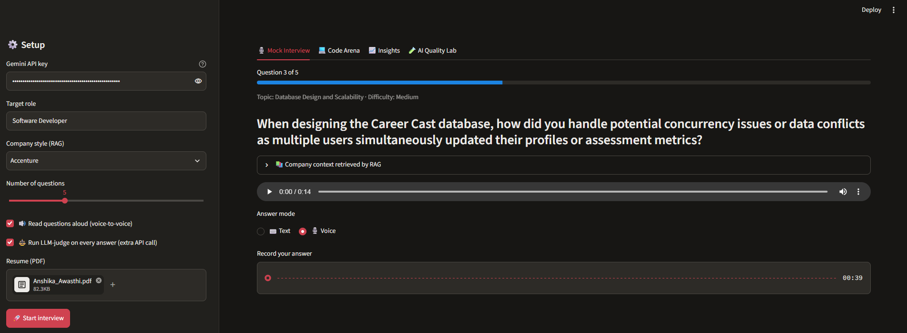
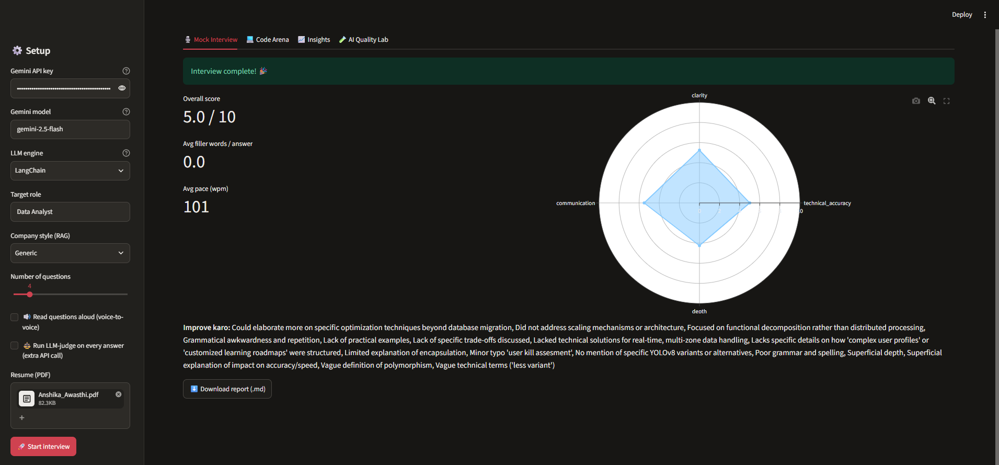
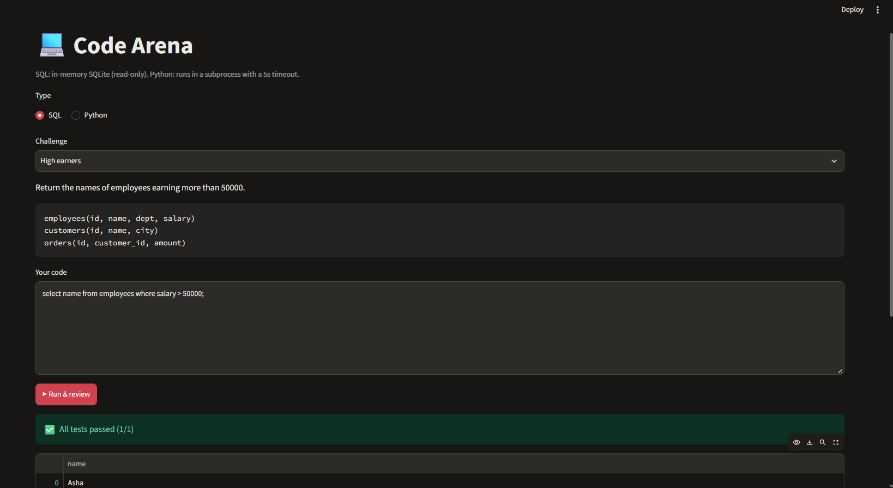
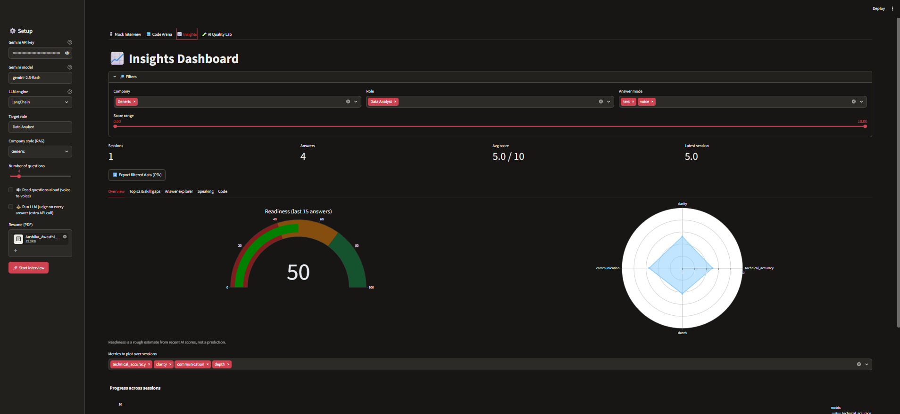
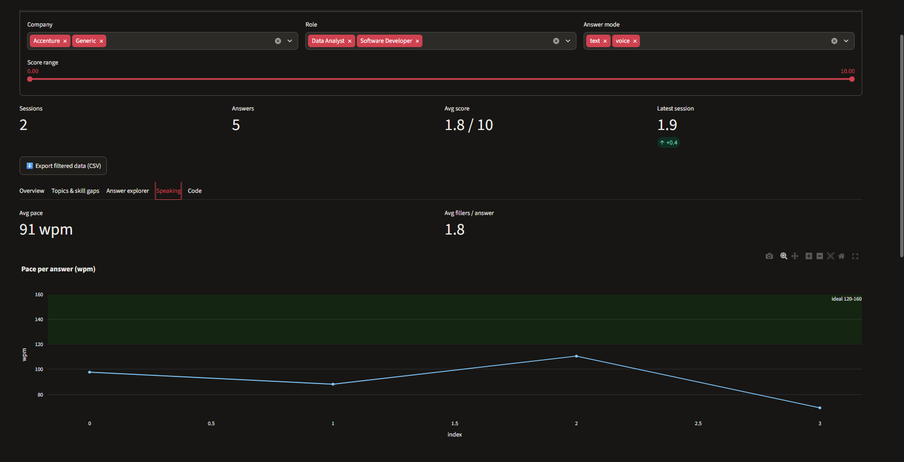
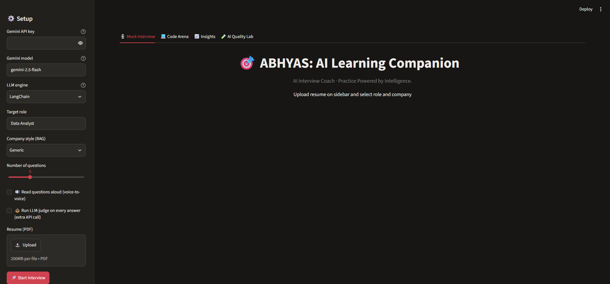
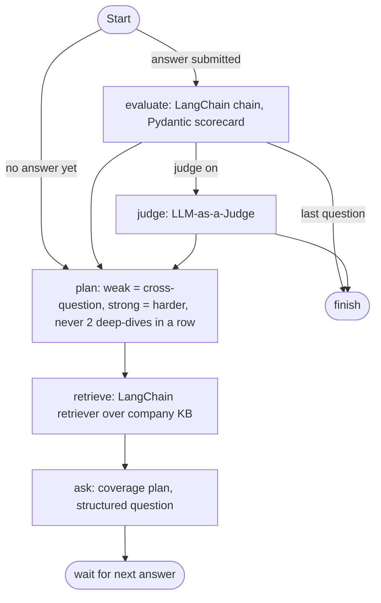

<div align="center">

# 🎯 Abhyas-AI
### AI Interview Coach: Practice Powered by Intelligence.

Upload your resume, pick a role and a company style, and get interviewed by voice or text.
Every answer is scored, weak spots get cross-questioned, and a dashboard tracks your progress.


**Live demo:** https://abhyas-ai-coach-igd2oiw2rcxjuhxibqvnv9.streamlit.app/

</div>

---

## 📸 Screenshots

### Resume-aware questions with a structured scorecard
Questions are generated from your own projects. Each answer is scored on four axes, with feedback, weak points and an ideal answer side by side.



### Voice mode with speaking analytics
Answer by speaking. The app transcribes your answer and measures pace (words per minute) and filler words.





### Session summary


### Code Arena (SQL and Python)


### Insights dashboard
Filter by company, role and answer mode. Track score trends, skill gaps and speaking pace over time.





### Home


---

## ✨ Features

| Area | What it does |
|------|--------------|
| **LangGraph workflow** | One interview turn is a state machine: `evaluate → (judge) → plan → retrieve → ask`, with conditional routing based on the score |
| **LangChain chains** | Every LLM step is an LCEL chain: `ChatPromptTemplate \| ChatGoogleGenerativeAI.with_structured_output(PydanticModel)` |
| **Company RAG** | Company and role knowledge base in ChromaDB, exposed as a LangChain `BaseRetriever`; keyword fallback if Chroma is unavailable |
| **Resume claim verification** | A coverage plan rotates questions across your projects, core fundamentals (OOP, DBMS...), role skills and behavioral topics |
| **Adaptive difficulty** | Weak answer → cross-question, strong answer → harder question, and never two deep-dives in a row |
| **Structured scorecard** | Technical Accuracy, Clarity, Communication, Depth (Pydantic + Gemini JSON mode), plus weak points and a STAR-format ideal answer |
| **Voice mode** | Mic recording → Gemini transcription → evaluation. Questions can be read aloud (gTTS) |
| **Speaking analytics** | Words per minute, pace label and filler-word breakdown (um, uh, like, basically...) |
| **Code Arena** | SQL (read-only in-memory SQLite, result compared with a reference) and Python (subprocess with timeout and test cases), plus AI complexity review |
| **Insights dashboard** | Filters, readiness gauge, radar chart, topic × skill heatmap, answer explorer, speaking trends, CSV export |
| **AI Quality Lab** | LLM-as-a-Judge audits the evaluator (fairness, feedback quality, grounding); p50/p95 latency and success rate per call type |
| **Resilience** | Automatic retry on temporary 503 errors, friendly quota (429) messages, and the scorecard is kept even if the next question fails |
| **Privacy by design** | Each visitor's data is isolated by a per-session id; API keys are kept per session, never shared |

---

## 🧠 How it works

One interview turn is a LangGraph graph (`interview_graph.py`). The Streamlit session keeps the state between turns.



### Design decisions
- **LangGraph for the flow, not just prompts.** Routing (follow-up vs harder vs new topic) is explicit, testable code instead of hidden inside one big prompt.
- **Structured outputs everywhere.** Pydantic schemas make scores, questions and judgments machine-readable, so they can be stored and charted.
- **A raw-SDK baseline.** The sidebar **LLM engine** switch runs the same graph with LangChain (default) or the direct Gemini SDK, which helps with debugging and comparison.
- **Measure the AI, don't just trust it.** The judge tab and latency tracking exist so evaluator quality and speed can be inspected.
- **Fail soft.** If question generation fails (quota, busy model), the user keeps the scorecard and retries with one click.

---

## 🛠 Tech stack

| Layer | Tools |
|-------|-------|
| Language | Python |
| UI | Streamlit |
| LLM orchestration | LangGraph, LangChain (`langchain-core`, `langchain-google-genai`) |
| LLM | Google Gemini (structured output, audio transcription) |
| RAG | ChromaDB, wrapped as a LangChain retriever |
| Validation | Pydantic |
| Voice | Streamlit `st.audio_input`, gTTS |
| Data and charts | SQLite, pandas, Plotly |
| Resume parsing | pypdf |

---

## 📁 Project structure

```
abhyas-ai/
├── app.py                 # Streamlit UI (interview, code arena, insights, AI quality lab)
├── interview_graph.py     # LangGraph workflow
├── lc_chains.py           # LangChain chains and retriever
├── llm.py                 # Prompts, schemas, Gemini SDK baseline, retries, transcription
├── kb.py                  # ChromaDB knowledge base (keyword fallback)
├── kb/question_bank.json  # Company and role knowledge base
├── voice.py               # Pace and filler-word analysis, text-to-speech
├── sandbox.py             # SQL and Python code arena
├── db.py                  # SQLite storage (per-visitor isolation)
├── tests/                 # Offline tests (fake LLMs, no API key needed)
├── eval/run_eval.py       # Golden-answer check for the evaluator
└── assets/                # README screenshots
```

---

## 🚀 Getting started

**Requirements:** Python 3.11 or newer and a free Gemini API key from [Google AI Studio](https://aistudio.google.com).

```bash
git clone https://github.com/awasthi-anshika801/abhyas-ai.git
cd abhyas-ai
python -m venv .venv
.venv\Scripts\activate          # Windows   (macOS/Linux: source .venv/bin/activate)
pip install -r requirements.txt
streamlit run app.py
```

Paste your Gemini API key in the sidebar (it is only used for your session), or set it as an environment variable:

```bash
set GEMINI_API_KEY=your_key      # Windows   (macOS/Linux: export GEMINI_API_KEY=your_key)
```

**Using PyCharm:** open the folder, create a virtual environment under *Settings → Python Interpreter*, run `pip install -r requirements.txt` in the terminal, then `streamlit run app.py`.

### Troubleshooting
| Message | Meaning and fix |
|---------|-----------------|
| `429 RESOURCE_EXHAUSTED` | Free-tier quota used up for that model. Change **Gemini model** in the sidebar (for example `gemini-2.5-flash-lite`) or wait for the daily reset |
| `503 UNAVAILABLE` | Model temporarily busy. The app retries automatically; if it still fails, wait a minute or switch model |
| Microphone not working | Allow mic access in the browser; voice recording needs `localhost` or HTTPS |

---

## ✅ Tests and evaluation

```bash
python tests/test_offline.py   # voice analysis, SQL/Python sandbox, KB, DB isolation, retry logic (no API key)
python tests/test_graph.py     # LangGraph routing and LangChain chains with fake LLMs (no API key)
python eval/run_eval.py        # needs a key: golden answers must rank strong > medium > weak >= empty
```

---

## ☁️ Deploy (Streamlit Community Cloud)

1. Push the repo to GitHub (never commit API keys; `.gitignore` already excludes `.env` and `*.db`).
2. On [share.streamlit.io](https://share.streamlit.io) choose **New app**, pick this repo, branch `main`, main file `app.py`.
3. In *Advanced settings* choose Python 3.11 or 3.12.
4. **Do not** put your own key in Secrets for a public app, otherwise visitors would use up your free quota. Each visitor pastes their own free key in the sidebar.

Note: the SQLite file is ephemeral on Streamlit Cloud, so the dashboard works as per-session analytics there.

---

## ⚠️ Limitations

- `kb/question_bank.json` contains **general, illustrative interview patterns** written for this project, not scraped real interview experiences. Add genuine experiences to make it more realistic, then delete the `.chroma/` folder to rebuild the index.
- AI scores are estimates, not ground truth. The AI Quality Lab exists to measure how reliable they are.
- The Python code arena runs code in a subprocess with a timeout. It is **not** a hardened sandbox, so do not expose it publicly without containerization.
- Speech-to-text uses the Gemini SDK directly (not LangChain), and embeddings come from Chroma's default model.

## 🗺 Roadmap
- [ ] Real company interview experiences in the knowledge base, with hybrid search and reranking
- [ ] RAG and answer evaluation with Ragas, plus tracing with Phoenix or Langfuse
- [ ] FastAPI backend and Docker image
- [ ] Multi-agent interviewer (interviewer, evaluator and coach agents)

---

<div align="center">

Built by [@awasthi-anshika801](https://github.com/awasthi-anshika801) · Feedback and ideas are welcome via Issues

</div>
