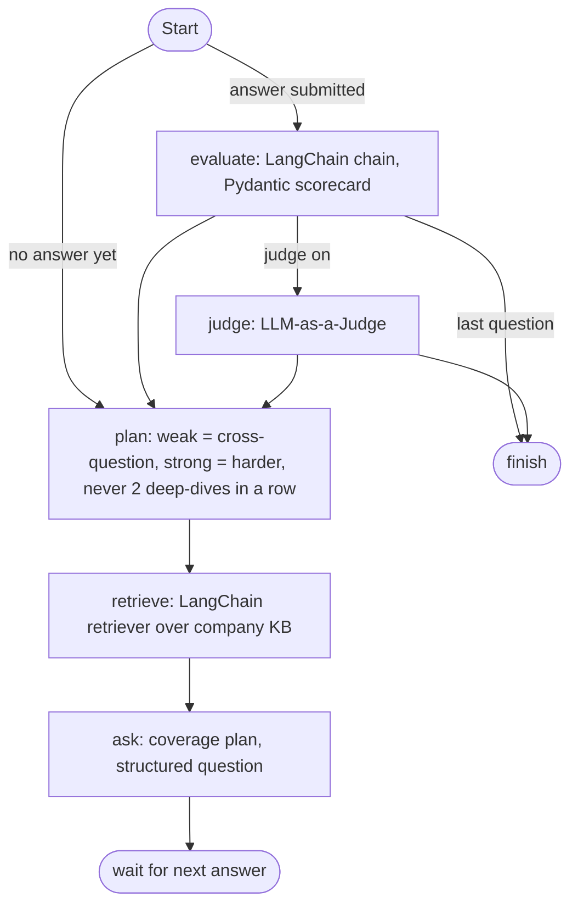

# 🎯 Abhyas AI
**AI Interview Coach** · *Abhyas (अभ्यास) = practice. Practice like it's the real thing.*

GenAI + data-analytics project: resume + role + company dene par mock interview (text ya voice),
structured scoring, adaptive cross-questions, code lab, aur analytics dashboard.

## Features
| Area | What it does |
|------|--------------|
| **LangGraph workflow** | The interview is a LangGraph state machine: evaluate -> (judge) -> plan -> retrieve -> ask, with conditional routing on the score |
| **LangChain chains** | Each LLM step is an LCEL chain: `ChatPromptTemplate \| ChatGoogleGenerativeAI.with_structured_output(PydanticModel)` |
| **Company RAG** | ChromaDB knowledge base (`kb/question_bank.json`) exposed as a LangChain `BaseRetriever` (`KBRetriever`); retrieved context steers question generation (keyword fallback if Chroma is unavailable) |
| **Resume claim verification** | Questions deep-dive into projects listed in your resume |
| **Adaptive difficulty** | Weak answer (<5) -> same-topic cross-question; strong (>=7.5) -> harder question |
| **Structured scorecard** | Pydantic schema + Gemini JSON mode: Technical Accuracy, Clarity, Communication, Depth |
| **Ideal vs your answer** | Side-by-side, STAR-format ideal answer for behavioral questions |
| **Voice mode** | Mic recording (`st.audio_input`) -> Gemini transcription -> evaluation; questions read aloud with gTTS |
| **Speaking analytics** | Words per minute, pace label, filler-word breakdown (um, uh, like, basically...) |
| **Code Lab** | SQL (read-only in-memory SQLite, result compared with reference) and Python (subprocess, timeout, test cases) + AI complexity review |
| **Dashboard** | Radar chart, score trend, topic-wise weak areas, speaking trend, code pass rate (SQLite) |
| **AI Quality tab** | LLM-as-a-Judge audits the evaluator; p50/p95 latency and success rate per call type |

## Architecture
One interview turn is a LangGraph graph (`interview_graph.py`). The caller keeps the state between turns.



Files: `app.py` (Streamlit UI) · `interview_graph.py` (LangGraph) · `lc_chains.py` (LangChain chains + retriever) ·
`llm.py` (prompts, schemas, raw Gemini SDK baseline, transcription) · `kb.py` (ChromaDB) · `db.py` · `voice.py` · `sandbox.py`.
The sidebar **LLM engine** switch runs the same graph with LangChain (default) or the raw SDK (fallback/baseline).

## Run locally
```bash
pip install -r requirements.txt
export GEMINI_API_KEY=your_key      # Windows: set GEMINI_API_KEY=your_key
streamlit run app.py
```

## Tests and evaluation
```bash
python tests/test_offline.py     # no API key needed (voice, SQL, Python sandbox, KB, DB)
python tests/test_graph.py       # LangGraph routing + LangChain chains with fake LLMs
python eval/run_eval.py          # golden answers must rank strong > medium > weak >= empty
```

## Deploy (Streamlit Community Cloud)
1. Push this repo to GitHub (never commit API keys; `.gitignore` already excludes `.env` and `*.db`).
2. share.streamlit.io -> **New app** -> pick the repo, branch `main`, main file `app.py`.
3. Advanced settings: Python 3.11 or 3.12.
4. **Do not** put your own key in Secrets for a public app: visitors would burn your free quota.
   Each visitor pastes their own free Gemini key in the sidebar (kept only in their session).
5. Each visitor's data is isolated by a per-session id. The SQLite file is ephemeral on Cloud
   (resets on reboot/redeploy), so treat the dashboard as per-session analytics.

Live demo: _add your Streamlit link here_

## Notes and limitations
- `kb/question_bank.json` contains **general, illustrative interview patterns**, not scraped
  real experiences. Add genuine experiences (e.g. from your seniors) to improve realism, then delete `.chroma/`.
- Python sandbox uses a subprocess with a timeout; it is **not hardened**. Don't expose it publicly
  without containerization.
- Speech-to-text (transcription) uses the Gemini SDK directly, not LangChain; embeddings come from Chroma's default model.
- LLM scores are an estimate, not ground truth; the judge tab exists to measure that.

## PyCharm me run karna
1. `File > Open` se `abhyas-ai` folder kholo.
2. `Settings > Project > Python Interpreter` me new virtual env (venv) banao.
3. Terminal (PyCharm ke neeche) me: `pip install -r requirements.txt`
4. API key set karo: terminal me `set GEMINI_API_KEY=your_key` (Windows) ya app ke sidebar me paste karo.
5. `streamlit run app.py` chalao, browser me app khulega.
(Run/Debug config chahiye to: Module name `streamlit`, Parameters `run app.py`.)
